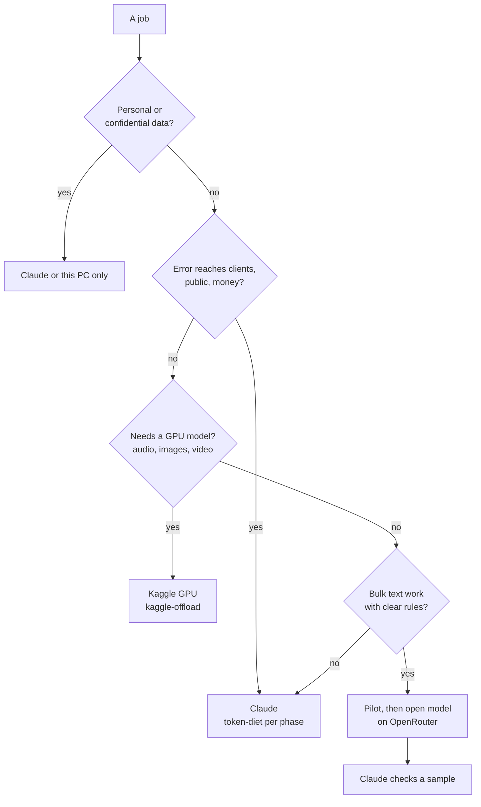
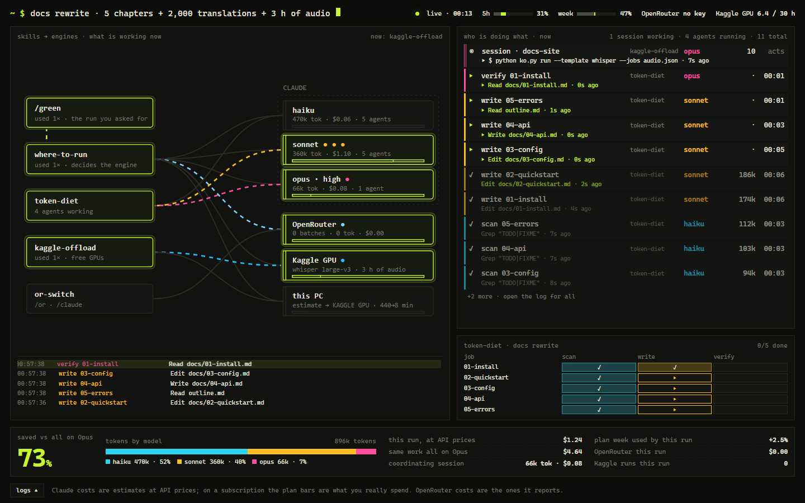

<div align="center">


# green-compute

**Spend less compute for the same work: each job on the cheapest engine that does it well.**

A Claude Code plugin bundle · Claude where it matters, open models where they're enough, free GPUs for the heavy lifting, your CPU left free

[](LICENSE)


</div>

## Why

Most AI work runs on the most expensive engine by default. Yet a long job is made of parts that need very different things: reading and sorting, writing to a template, transcribing audio, checking that what ships is right. Only some of it needs the top model; some of it doesn't need a frontier model at all; some of it needs a GPU your laptop doesn't have.

green-compute puts four tools behind one question, **where should this run?**, so you pay with money, plan quota or your machine's time only where it buys quality.

## What's inside

| Plugin | What it does |
|---|---|
| **green-compute** | the `where-to-run` skill (Claude, an open model on OpenRouter, Kaggle's free GPUs or your PC?), the `/green` command, a live control room that shows every skill, agent, model and engine at work, and scripts for OpenRouter's live prices and text batches |
| [**token-diet**](https://github.com/fracabu/token-diet) | the right Claude model and effort for each phase of a job, with a live monitor of what you save |
| [**kaggle-offload**](https://github.com/fracabu/kaggle-offload) | runs heavy AI jobs on Kaggle's free GPUs (about 30 hours a week), batches them, tracks the quota |
| [**or-switch**](https://github.com/fracabu/or-switch) | `/or` moves the conversation to an OpenRouter model (DeepSeek, Kimi, Qwen, GLM, Gemini, free ones), `/claude` brings it back. Windows |

Installing green-compute installs the other three as dependencies. Each one can also be installed on its own.

## How it decides



Before any job that computes on your PC, the skill **estimates** it (by calculation, or by timing a few items) and sends it straight to Kaggle when it would hold the CPU above 50% for 5 minutes or more, or when Kaggle would finish in less than half the time: faster, and the PC stays free. Before any bulk run on an open model, the skill runs a **pilot**: the same 5-10 items on the open model and on Claude, compared side by side. It only goes on if quality holds, and a sample of the batch is checked on Claude afterwards.

## The control room

One page, the whole window, no scrolling: which skill is working, every sub-agent with its model, tokens and time, what each engine is doing (Claude's models, OpenRouter, Kaggle's GPU, your PC's CPU), what the run costs against "all on Opus", and your plan's 5-hour and weekly usage. The event log opens from a button at the bottom (or the `L` key).



You don't feed it by hand. The plugin's hooks module listens to Claude Code: when one of green-compute's skills runs in a session, it starts the room on `localhost:4790`, opens it, and from then on records every skill, sub-agent spawn and report, the token usage of every turn, and the batches sent to OpenRouter or Kaggle. Sessions that never use these skills record nothing.

**`/green <the job>`** is the explicit way in. Type it before a job you already know needs this: it opens the control room with the job as the run's title, decides where each part runs with `where-to-run`, then does the job.

```
/green translate the 2,000 product pages to English and transcribe the 3 hours of interviews
```

To see it with made-up data: `node control-room/demo.mjs` from the plugin's folder (port 4791, nothing real is read).

## Install

In a Claude Code session (2.1.275 or later):

```
/plugin install green-compute --marketplace fracabu/green-compute
```

Or only one piece: `/plugin install token-diet --marketplace fracabu/green-compute` (same for `kaggle-offload` and `or-switch`).

**Which scope?** Choose **user scope** ("install for you"), so you get it in every project. The skills cost only their one-paragraph descriptions until a job calls for them, and or-switch only adds two commands. Pick **local scope** instead if you want it in some repositories only, or **project scope** to share it with a team through the repository's settings.

Then, for the parts you'll use:

- **OpenRouter**: an API key from [openrouter.ai](https://openrouter.ai), either in `OPENROUTER_API_KEY` (`setx OPENROUTER_API_KEY "sk-or-v1-..."` on Windows) or in a `.env` file in the plugin's folder (copy `.env.example`; it is git-ignored). Set a credit limit on the key.
- **Kaggle**: `pip install kaggle`, a Kaggle account with a verified phone number and an API token: see [kaggle-offload](https://github.com/fracabu/kaggle-offload#quick-start).
- **Direct tasks** (optional): send some kinds of work straight to one OpenRouter model, with no pilot against Claude, in `~/.green-compute/config.json`:

  ```json
  { "direct": { "model": "qwen/qwen3.8-27b", "tasks": ["translate", "summarize", "classify", "extract", "draft"] } }
  ```

  A first live test on 27 November 2026: one translation, one summary, one classification, one extraction to JSON and one short draft on `qwen/qwen3.8-27b`, all correct, $0.0003 in total, about a second each. `node scripts/config.mjs` shows the settings in force.
- **Plan usage in token-diet's monitor**: an optional status line, see [token-diet](https://github.com/fracabu/token-diet#optional-plan-usage-in-the-monitor).

## Usage

Just ask Claude: *"where should this run?"*, *"can DeepSeek do this part?"*, *"translate these 500 files cheaply"*, *"I'm out of Claude for the week"*, *"keep my CPU free"*. The scripts also work on their own, from the plugin's folder:

| Command | What it does |
|---|---|
| `node scripts/estimate.mjs --pilot "<command on 2 items>" --items-pilot 2 --items-total 120` | estimates a job before it runs (also `--gflop`, or `--params-b` with `--tokens`) and applies the CPU and time rules: Kaggle when the job would hold the CPU above 50% for 5+ minutes, or Kaggle would finish in less than half the time; limits in `~/.green-compute/config.json` |
| `node scripts/or-models.mjs` | newest Chinese open models with tool calling and their live prices, next to Claude's |
| `node scripts/or-models.mjs --group free` | the same for free models (`gemini`, `others`, `all` too; `--json` for scripts) |
| `node scripts/or-batch.mjs --model <id> --in jobs.jsonl --out results.jsonl --system "<rules>" --reasoning none` | runs `{"id", "prompt"}` lines on an OpenRouter model, 4 at a time, retries on rate limits, resumes a stopped run, prints the cost OpenRouter reports. `--reasoning none` or `low` for simple tasks |

Example from `or-models.mjs` on 27 November 2026, blended price per million tokens (85% input, 15% output): `deepseek/deepseek-v4.1-flash` $0.07, `qwen/qwen4-max` $1.85, `moonshotai/kimi-k3.1-pro` $1.46, against Claude Haiku $0.16, Sonnet $3.20, Opus $6.40. Prices change: the script reads them live every time.

## Privacy and limits

- **OpenRouter and Kaggle are third parties.** Whatever you send there (prompts, files, audio) leaves your machine and Anthropic. The skill keeps personal and confidential data away from both, and asks when unsure.
- **Open models are not Claude.** They can be excellent at bulk text work and weak at long agentic sessions. That's why there is a pilot before every batch and a check after it.
- **Prices are read live**, never quoted from memory: the figures above are an example with their date.
- Nothing here stores your keys: OpenRouter's is read from the environment, Kaggle's stays where Kaggle puts it.

## Status

Tested on Windows 11. The control room and its hooks module in a real headless session (a skill, a Haiku sub-agent, its tokens, the room starting on its own) and at 1280×720, 1440×900 and 1920×1080 with no scrolling. `or-models.mjs` and `or-batch.mjs` against the live OpenRouter API (a first live batch of translations on DeepSeek: with reasoning on, one answer came back empty because thinking used up `--max-tokens`; now that is an error that gets retried, and `--reasoning none` brought the cost down about tenfold), plus a local mock for retries and resume. Still to test: or-switch's full hand-off with a real key. macOS and Linux: untested, and or-switch needs a shell version of its launcher. Issues and reports are welcome.

## License

[MIT](LICENSE) · made by [@fracabu](https://github.com/fracabu)
